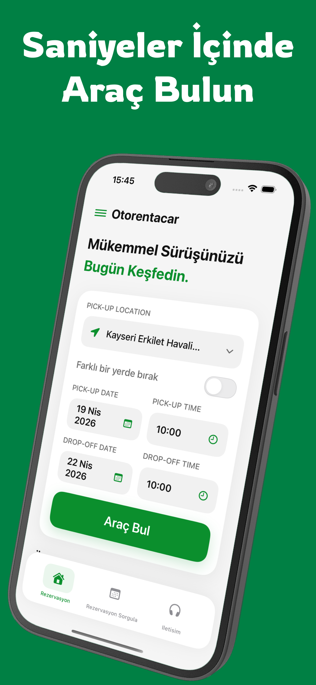
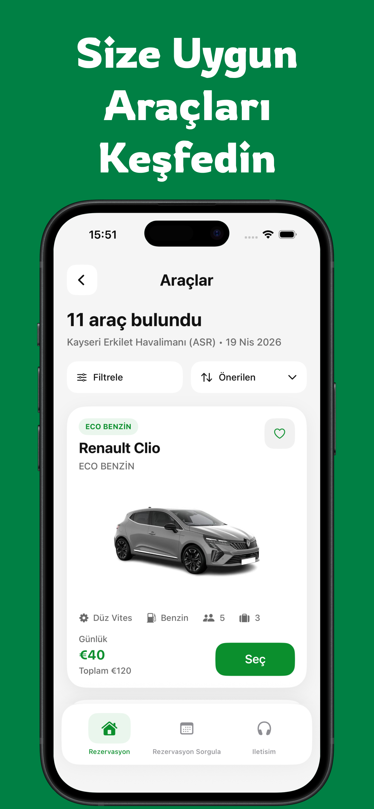
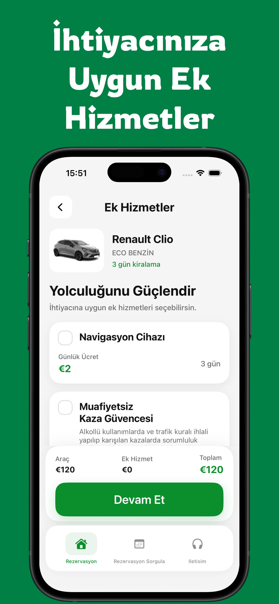
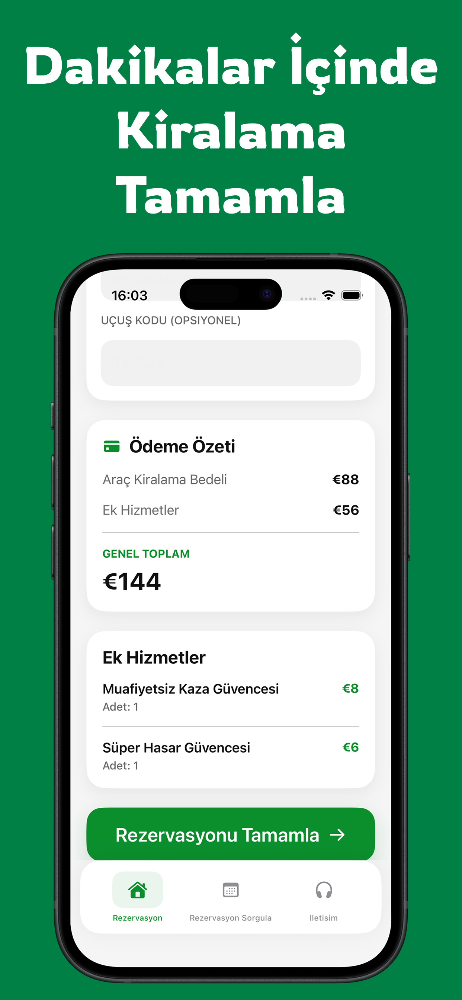
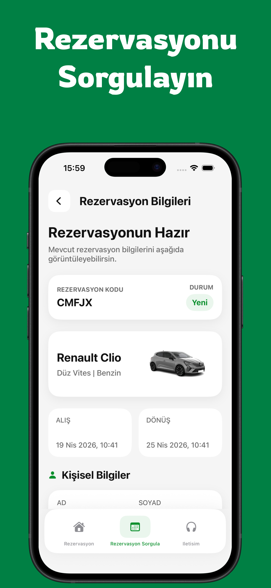

# Otorentacar – Car Rental Android App

A modern car rental Android application built with **Kotlin** and **Jetpack Compose**, allowing users to search vehicles, select extras, create reservations, and query existing bookings with a tracking code.

The application integrates with live backend services to provide real-time vehicle availability, pricing, and reservation management.

## Preview

<p align="center">
  
  
  
  
  
</p>

---

## Features

- Search available rental vehicles by pickup/drop-off location, date, and time
- Display live vehicle data from API
- Show vehicle images dynamically from backend responses
- Select extra services such as navigation and child seats
- Handle dynamic child age inputs for child seat selection
- Calculate total rental cost accurately based on rental duration
- Create reservations with customer details
- Support optional flight code during reservation
- Show reservation success screen with tracking code
- Copy reservation code easily
- Query reservations using tracking code
- Display reservation details and selected extras
- User-friendly and modern Android interface
- Responsive layouts with Jetpack Compose
- Google Play release preparation

---

## Tech Stack

- **Kotlin**
- **Jetpack Compose**
- **Android SDK**
- **Material Design**
- **REST API Integration**
- **JSON Data Handling**
- **Android Studio**
- **Gradle**

---

## Architecture

The project is structured with a clean and scalable architecture, separating user interface components, application logic, and backend communication.

### Main Layers

- **App**
  - Application entry point
  - Navigation setup
  - Application configuration

- **Core**
  - Helpers
  - Formatters
  - Session management
  - Shared utilities
  - Network configuration

- **Data**
  - API communication
  - Remote data handling
  - Response models
  - Data mapping

- **Features**
  - Home
  - Vehicle List
  - Extras
  - Reservation Detail
  - Reservation Confirmation
  - Reservation Query
  - About / Contact

- **UI**
  - Jetpack Compose screens
  - Reusable UI components
  - App theme
  - Colors
  - Typography

- **Resources**
  - Drawable assets
  - App icons
  - String resources
  - Application configuration

---

## API Integrations

This application works with live backend services and includes flows such as:

- Authentication / session preparation
- Location search
- Vehicle price search
- Extra services fetch
- Reservation creation
- Reservation query

The app also handles:

- Token-based requests
- Dynamic form-urlencoded request bodies
- JSON response parsing
- Backend validation messages
- Reservation tracking code retrieval
- Network response handling

---

## Key Implementation Details

### 1. Live Vehicle Listing

Vehicle data is fetched dynamically from the API instead of using mock data.

The home screen and vehicle listing screen use real backend responses to display available vehicles and rental prices.

### 2. Dynamic Image Loading

Vehicle images are loaded using backend-provided relative paths and converted into full image URLs for display in the Android application.

### 3. Reservation Flow

The reservation process includes:

- Customer information form
- Optional flight code
- Extras selection
- Reservation summary
- Total price calculation
- Reservation confirmation
- Success screen
- Reservation code copy action

### 4. Extras Handling

The project supports quantity-based extras and special dynamic inputs such as child age fields for child seat selection.

Selected extras are included in the reservation request and total rental price calculation.

### 5. Reservation Query Flow

Users can enter a reservation code and fetch reservation details from the backend.

Queried reservations are mapped into application models and displayed in a dedicated reservation detail screen.

### 6. Jetpack Compose UI

The application interface is developed using Jetpack Compose.

Reusable composable components are used to build a consistent and modern Android user experience.

The interface includes dynamic forms, interactive selection components, and reservation screens.

---

## Challenges Solved

During development, several real-world issues were solved:

- Correct rental day calculation based on hour difference instead of simple date difference
- Backend-compatible extras parameter formatting
- Reservation total mismatch resolution
- Dynamic child seat age input handling
- Live vehicle image integration
- Reservation query enrichment for missing visual data
- API response parsing and data mapping
- Authentication and session handling
- Dynamic form state management
- Maintaining consistent UI behavior across reservation screens
- Adapting the rental experience to Android using Jetpack Compose

---

## Screenshots

### Home

Search for available cars by location, date, and time.

### Vehicle Listing

Browse available vehicles with live prices and backend images.

### Extras

Select additional services to customize the rental experience.

### Reservation

Complete reservation details and review the total rental price.

### Reservation Query

Track an existing booking using a reservation code.

---

## What I Learned

This project helped me improve my skills in:

- Building modern Android applications with Kotlin
- Developing user interfaces with Jetpack Compose
- Structuring Android projects with clean and reusable components
- Integrating real REST APIs
- Handling backend responses and edge cases
- Managing dynamic UI states
- Designing reusable composable components
- Implementing complex reservation workflows
- Handling asynchronous network operations
- Building production-style Android applications
- Adapting an existing iOS application experience to Android

---

## Future Improvements

- Favorites persistence
- Sorting and filtering improvements
- Multi-language support
- Better offline/error states
- Reservation cancellation / update support
- Push notifications for reservation updates
- Local data caching
- Unit tests for networking and application logic
- UI testing
- Performance improvements

---

## Installation

1. Clone the repository:

   ```bash
   git clone https://github.com/your-username/otorentacarAndroid.git
   ```

2. Open the project in Android Studio.
3. Wait for Gradle synchronization to complete.
4. Add required API configuration values.
5. Select an Android emulator or physical device.
6. Build and run the application.

---

## Notes

This project was developed as a real-world car rental Android application focusing on:

- Clean architecture
- Live API usage
- Modern Android development
- Jetpack Compose UI
- Reusable components
- Production-like user flows
- Release readiness

The application brings the Otorentacar rental experience to Android with a modern, native user interface.

---

## Author

**Mustafa Ölmezses**
